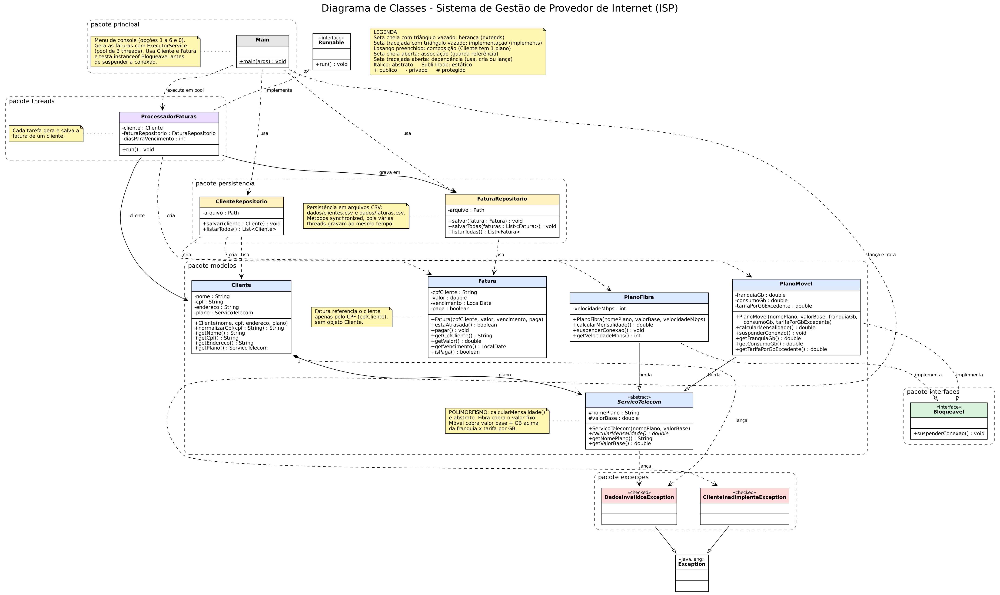

# 📌 Apresentação Final POO

Projeto final da disciplina **C06 – Programação Orientada a Objetos** (NP2) — Inatel
Professor: **Christopher Lima**

---

## 📖 Sobre o Projeto

**Tema:** Sistema de Gestão de Provedor de Internet (ISP).

**Problema:** Provedores de internet de pequeno e médio porte costumam controlar clientes, planos e cobranças de forma manual, em planilhas. Cada tipo de plano cobra de um jeito: a fibra tem mensalidade fixa, e o plano móvel varia conforme o consumo de dados acima da franquia. Calcular tudo à mão, gerar as faturas de muitos clientes de uma vez e descobrir quem está com fatura vencida para suspender o serviço são tarefas lentas e sujeitas a erro, o que causa cobranças incorretas e atraso na suspensão de inadimplentes.

**Solução:** Uma aplicação em Java, executada pelo console, que organiza esse processo:

- **Cadastro de clientes**, cada um com um plano de Fibra ou Móvel. Os dados são validados **na hora da digitação**: se o nome ou o endereço estiverem vazios ou tiverem `;`, ou se o CPF não tiver 11 dígitos, o sistema mostra um aviso `>> ATENÇÃO` e pede o dado de novo. Plano com valor base menor ou igual a zero é recusado.
- **Cálculo automático da mensalidade:** cada plano calcula a sua. A fibra cobra o valor fixo, e o móvel soma a tarifa dos GB que passam da franquia.
- **Geração de faturas em paralelo**, com um pool de threads (`ExecutorService`, 3 threads), em que cada cliente vira uma tarefa, o que agiliza o processamento quando há muitos clientes.
- **Pagamento de faturas** pelo CPF do cliente, que atualiza o arquivo.
- **Persistência em arquivos CSV**, que guardam clientes e faturas entre as execuções, sem precisar de banco de dados.
- **Controle de inadimplência:** o sistema identifica quem tem fatura vencida e não paga, trata isso com uma exceção de negócio e suspende a conexão do cliente.

### 🎓 Relevância ao Curso

O projeto trabalha a Engenharia de Software, ao aplicar modelagem orientada a objetos (UML), herança, polimorfismo, interfaces e classes abstratas, tratamento de exceções, persistência em arquivos e programação concorrente. Também se liga à Telecomunicações, porque o domínio é o de uma operadora: planos de fibra e móvel, franquia de dados, cobrança de excedente e suspensão por inadimplência. É um projeto multidisciplinar, como o enunciado permite.

---

## 👥 Integrantes

| Nome | Matrícula | Curso | GitHub |
|------|-----------|-------|--------|
| André Luiz | 967 | GES | [@Andre](https://github.com/andre14dev) |
| Monique Amorim | 612 | GES | [@Mon-Amor](https://github.com/Mon-Amor) |
| Thaís Emanuelle Prado de Oliveira | 264 | [Curso] | [@thaismanu1](https://github.com/thaismanu1) |
| Victor Rafhael Rodrigues Honorato | [INSERIR MATRÍCULA AQUI] | Engenharia de Telecomunicações | [@honorato-victor](https://github.com/honorato-victor) |

---

## 🛠️ Tecnologias Utilizadas

- **Linguagem:** Java 21
- **Framework / Bibliotecas:** Nenhuma
- **Banco de Dados / Arquivos:** Arquivos CSV

---

## 🚀 Como Executar

### Pré-requisitos

- JDK 21 ou superior (`javac` e `java` disponíveis no terminal)
- Git (para clonar o repositório)
- Nenhuma biblioteca externa nem banco de dados

### Passo a passo

```bash
# 1. Clone o repositório
git clone https://github.com/andre14dev/Projeto_Orientacao_a_obj.git

# 2. Entre na pasta do projeto (a raiz, onde estão src/ e README.md)
cd Projeto_Orientacao_a_obj

# 3. Compile (o javac encontra sozinho todas as classes usadas pelo Main)
javac -encoding UTF-8 -d out -sourcepath src src/principal/Main.java

# 4. Execute a partir da raiz (a pasta dados/ é criada aqui)
java -Dfile.encoding=UTF-8 -cp out principal.Main
```

**Windows:** no `cmd` e no Git Bash use os comandos acima (no `cmd`, `src\principal\Main.java`). No **PowerShell** é preciso colocar o parâmetro entre aspas, senão ele é interpretado errado:

```powershell
javac -encoding UTF-8 -d out -sourcepath src src\principal\Main.java
java "-Dfile.encoding=UTF-8" -cp out principal.Main
```

**IntelliJ IDEA:** abra a pasta do projeto, marque `src` como *Sources Root*, escolha o JDK 21, defina o *Working directory* como a raiz do projeto e execute `principal.Main`.

Os arquivos `dados/clientes.csv` e `dados/faturas.csv` são criados automaticamente no primeiro cadastro e na primeira geração de faturas.

### Menu do sistema

| Opção | O que faz |
|-------|-----------|
| 1 - Cadastrar cliente | Pede nome, CPF, endereço e dados do plano (Fibra ou Móvel), validando cada dado na hora. |
| 2 - Listar clientes | Mostra os clientes e a mensalidade de cada um, calculada pelo plano (polimorfismo). |
| 3 - Gerar faturas | Pede os dias até o vencimento (use negativo para simular fatura vencida) e gera as faturas em paralelo, em um pool de 3 threads. |
| 4 - Listar faturas | Mostra as faturas com a situação: ABERTA, PAGA ou ATRASADA. |
| 5 - Pagar fatura | Pelo CPF, marca como paga a primeira fatura em aberto do cliente. |
| 6 - Verificar inadimplência | Lança `ClienteInadimplenteException` para quem tem fatura vencida e suspende a conexão do plano (`Bloqueavel`). |
| 0 - Sair | Encerra o programa. |

### Exemplo de uso

1. Opção `1`: cadastre um cliente de fibra e um de plano móvel. Se digitar um CPF com menos ou mais de 11 dígitos, o sistema avisa e pergunta de novo.
2. Opção `2`: veja as mensalidades. A fibra cobra o valor fixo. O móvel soma os GB acima da franquia (por exemplo: base R$ 50, franquia 5 GB, consumo 8 GB e tarifa R$ 2 por GB resultam em R$ 56,00).
3. Opção `3` com `-5`: gera as faturas já vencidas. Opção `4`: elas aparecem como ATRASADA.
4. Opção `6`: os clientes inadimplentes são identificados e suspensos.
5. Opção `5` com o CPF de um cliente e depois a `6`: ele passa a aparecer "em dia".

---

## 📁 Estrutura do Projeto

```
projeto_final/
├── src/
│   ├── modelos/
│   │   ├── ServicoTelecom.java        (abstrata)
│   │   ├── PlanoFibra.java
│   │   ├── PlanoMovel.java
│   │   ├── Cliente.java
│   │   └── Fatura.java
│   ├── interfaces/
│   │   └── Bloqueavel.java
│   ├── excecoes/
│   │   ├── DadosInvalidosException.java
│   │   └── ClienteInadimplenteException.java
│   ├── persistencia/
│   │   ├── ClienteRepositorio.java
│   │   └── FaturaRepositorio.java
│   ├── threads/
│   │   └── ProcessadorFaturas.java
│   └── principal/
│       └── Main.java
├── dados/
│   ├── clientes.csv                   (gerado ao executar)
│   └── faturas.csv                    (gerado ao executar)
├── docs/
│   └── uml/
│       └── diagrama.png               (e o .drawio editável)
├── .gitignore
└── README.md
```

---

## 🧩 Conceitos de POO Aplicados

| Conceito | Onde foi aplicado |
|----------|-------------------|
| **Classes** | `Cliente` (nome, CPF, endereço e plano, com construtor que valida os dados), `Fatura` (CPF, valor, vencimento e situação) e as classes de plano, todas com atributos encapsulados, construtores e métodos de acesso. |
| **Herança** | `ServicoTelecom` → `PlanoFibra` e `ServicoTelecom` → `PlanoMovel`. As filhas herdam `nomePlano` e `valorBase` e chamam `super(...)` no construtor. |
| **Polimorfismo** | `calcularMensalidade()` é chamado por uma referência `ServicoTelecom` no `Main` e no `ProcessadorFaturas`, e cada plano responde do seu jeito (fibra: valor fixo; móvel: valor base + excedente da franquia). Também há `instanceof Bloqueavel` antes de suspender a conexão. |
| **Interfaces** | `Bloqueavel` (`suspenderConexao()`), implementada por `PlanoFibra` e `PlanoMovel`. |
| **Classes Abstratas** | `ServicoTelecom`, com o método abstrato `calcularMensalidade()`, estendida por `PlanoFibra` e `PlanoMovel`. Não pode ser instanciada. |
| **Tratamento de Erros** | Exceções personalizadas verificadas: `DadosInvalidosException` (nome, CPF, endereço e valor do plano inválidos; o `Main` também valida na hora da digitação e pede o dado de novo) e `ClienteInadimplenteException` (fatura vencida e não paga). `IOException` e `NumberFormatException` são tratadas no `Main` e nos repositórios; linhas corrompidas do CSV são ignoradas com aviso. |
| **Arquivos ou Banco de Dados** | Arquivos CSV (`dados/clientes.csv` e `dados/faturas.csv`) lidos e gravados com `java.nio.file` (`Files`, `Path`) em UTF-8, por `ClienteRepositorio` e `FaturaRepositorio`. Sem banco de dados. |
| **Threads** | `ProcessadorFaturas` (`Runnable`) gera e salva a fatura de um cliente. O `Main` usa `ExecutorService` com pool de 3 threads para processar vários clientes em paralelo. `FaturaRepositorio` usa métodos `synchronized` para gravar com segurança. |

---

## 📐 Diagrama UML

O diagrama UML completo está disponível em [`docs/uml/uml.png`](docs/uml/uml.png).



---

## 🤖 Uso de Inteligência Artificial

**Links das conversas:**

**André Luiz**
[link da conversa1](https://claude.ai/share/bc9611e1-565c-4908-9951-68b4d8a1651f)
[link da conversa2](https://chatgpt.com/share/6afbbd96-31cc-83e8-a52d-f4510c17aca7)

**Monique Amorim**
[Link da conversa](https://share.gemini.google/0XR1DK1Yx0GM)

**Thaís Emanuelle Prado de Oliveira**
[Link da conversa](https://chatgpt.com/share/6afbb172-273c-83e8-b1f7-0474b8385578)

**Victor Rafhael Rodrigues Honorato (Pessoa 4)**
Utilizei IA para estruturar a lógica de persistência com java.nio e a paralelização do processamento de faturas usando Runnable e Thread.
[link da conversa]